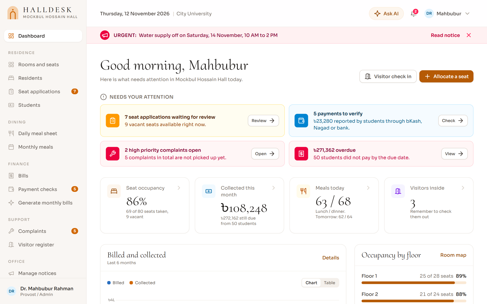
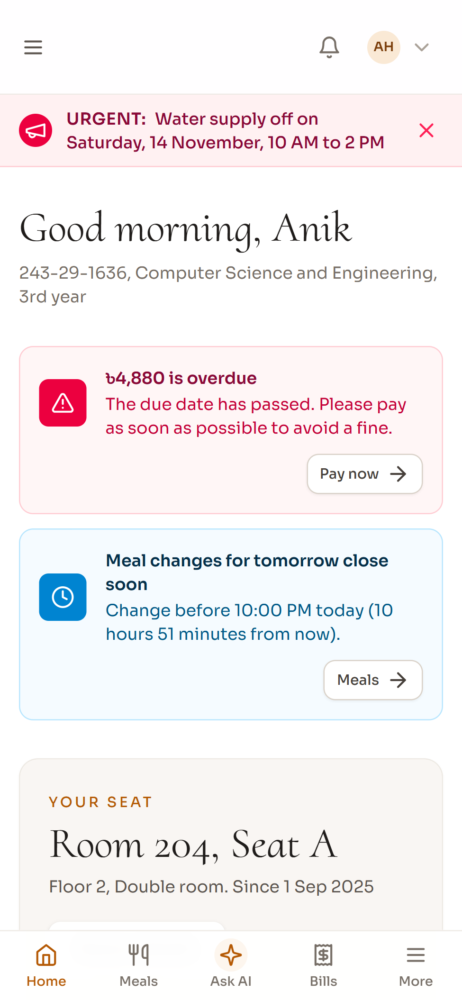
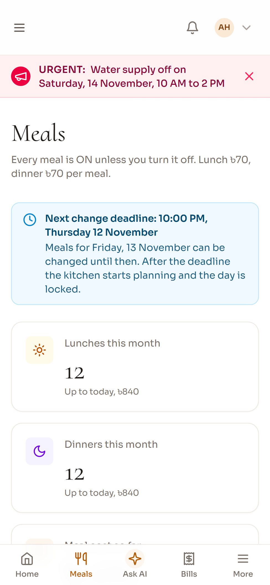
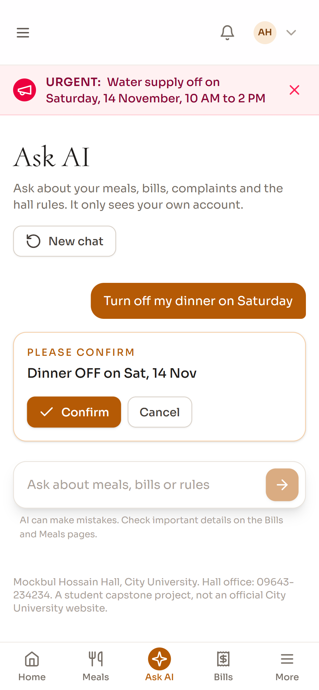

# HallDesk

A hall management system I built for my capstone at City University. It is set up for Mockbul Hossain Hall: students apply for a seat, turn meals on and off, pay their monthly bill and file complaints, and the hall office runs everything from one dashboard.

Live demo: **https://144-79-133-115.sslip.io**
On the sign in page, tap one of the demo accounts (provost, staff, resident or applicant) and you are in.

It is a student project, not an official City University website. The university's name and contact details are real, everything else (students, rooms, bills) is demo data.

<p>
  
</p>
<p>
  
  
  
</p>

## What it does

**Students** register with their student ID and apply for a seat. Once they have one they see their room and roommates, print the allotment letter, plan meals two weeks ahead or switch them off for a trip home, see every bill line by line, pay by bKash, Nagad, Rocket or bank, and follow their complaints.

**Hall staff** get the daily meal sheet for the kitchen, a queue of payments to check, complaints to pick up, the visitor register and the room map.

**The provost** can do all of that, plus review seat applications (sorted by CGPA and seniority), allocate and transfer seats, generate the monthly bills, post notices and change the hall settings.

There is also a phone app version, an AI assistant and a Telegram bot for the office, more on those below.

## The parts that took the most thought

**A seat can't be given twice.** `app/Services/AllocationService.php` checks it, and the database enforces it too with unique columns that only hold a value while an allocation is active. So two people clicking Allocate at the same moment can't both win.

**Meals are on by default and lock the night before.** Only the meals a student switches off are stored, so 80 residents over 60 days doesn't turn into 9,600 rows. At 10 PM the next day's numbers are final for the kitchen. See `app/Services/MealService.php`.

**The bill is simple maths, done once.** Seat rent and electricity are charged for the days actually stayed, meals by count:

```
rent        = room rent x days stayed / days in month
electricity = monthly charge x days stayed / days in month
meals       = lunches x lunch rate + dinners x dinner rate
```

A month can only be billed after it ends and only once per student, so pressing Generate twice does nothing. Money is whole taka, never floats. `app/Services/BillingService.php`

**Payments are checked, not trusted.** A student sends money by bKash or Nagad and types the transaction ID. The bill only changes when staff confirm it against their statement, and the same transaction ID can't be used twice. `app/Services/PaymentService.php`

## Phone app, Ask AI and alerts

**It installs like an app.** The site is a PWA, so on a phone you get an Install option, an icon on the home screen and a tab bar at the bottom. Pages are never cached because they hold personal data.

**Ask AI** (Google Gemini) can answer "how much do I owe?" or do things like "turn off my dinner on Saturday". It works through 13 small tools built on the same services as the pages, and each tool checks who is asking, so a student only ever sees their own data. Anything that changes something shows a Confirm button first, and it never pays a bill. Questions about hall rules are answered from `resources/hall/rules.md` and the notice board using embedding search, and if the answer isn't there it says so and gives the office phone number. Code is in `app/Services/Assistant/`.

**Push alerts.** A new bill, a payment result, a complaint update or a message from the provost also shows up on the phone as a notification, even with the app closed. Plain Web Push with VAPID keys, no outside service. (The live demo is one release behind and doesn't have this yet.)

**A Telegram bot for the office.** Staff link their account from the profile page. The bot sends the lunch list at 11 AM and the dinner list at 6 PM. Only the provost can send a message to every resident through it, and it asks before sending. `app/Services/Telegram/`

## Where things are

| If you want to change | Look in |
|---|---|
| Seats, meals, bills, payments, complaints | `app/Services/` |
| Who can open which page | `routes/web.php` and `app/Http/Middleware/EnsureRole.php` |
| Hall name, meal rates, electricity, payment numbers | the Hall settings page, defaults in `app/Support/Settings.php` |
| The hall rules Ask AI reads | `resources/hall/rules.md` |
| Layout, sidebar, phone tab bar | `resources/views/components/layouts/app.blade.php`, `resources/views/partials/tab-bar.blade.php` |
| Colours, buttons, cards | `resources/css/app.css` |
| Demo data | `database/seeders/DemoSeeder.php` |

The app has 18 tables of its own. The main ones are `users`, `student_profiles`, `rooms`, `seats`, `allocations`, `meal_offs`, `invoices`, `payments` and `complaints`, and `database/migrations/` has all of them.

## Running it yourself

You need PHP 8.3 or newer, Composer and Node.

```bash
composer install
cp .env.example .env
php artisan key:generate
php artisan migrate --seed     # builds the demo hall
npm install && npm run build
php artisan serve              # http://127.0.0.1:8000
```

Every demo account's password is `password` locally. `php artisan migrate:fresh --seed` resets the demo.

The extras stay off until you add their keys to `.env`. The rest of the app works without them.

| Feature | Put in `.env` | Where to get it |
|---|---|---|
| Ask AI | `GEMINI_API_KEY` | aistudio.google.com/apikey |
| Push alerts | `HALL_PUSH_PUBLIC_KEY`, `HALL_PUSH_PRIVATE_KEY` | run `php artisan push:keys` once |
| Office bot | `TELEGRAM_BOT_TOKEN` | @BotFather, then run `php artisan telegram:poll` |

Installing the app and push alerts need HTTPS, but `http://127.0.0.1` works for testing.

Don't commit `.env` or the database file. Both are in `.gitignore`.

## Tests

```bash
php artisan test
```

70 tests. They cover the double seat guard, the meal cutoff, bill maths, payment limits, who can open what, the Ask AI tools and confirmations, the Telegram bot and push alerts. Gemini, Telegram and the push service are faked, so no keys or internet needed.

## Built with

Laravel 13, Blade, Tailwind CSS 4, Alpine.js, Chart.js and SQLite (MySQL works too). Google Gemini for Ask AI, the Telegram Bot API for the office bot, `minishlink/web-push` for alerts.

The design is based on the free [Mellow](https://templatesjungle.com/) template by TemplatesJungle, rebuilt in Tailwind. Most photos in `public/images/hall/` are placeholders from that template, except `about-2.jpg`, which is the hall building from the university website. Swap any of them by replacing the file with the same name.

MIT licensed.
